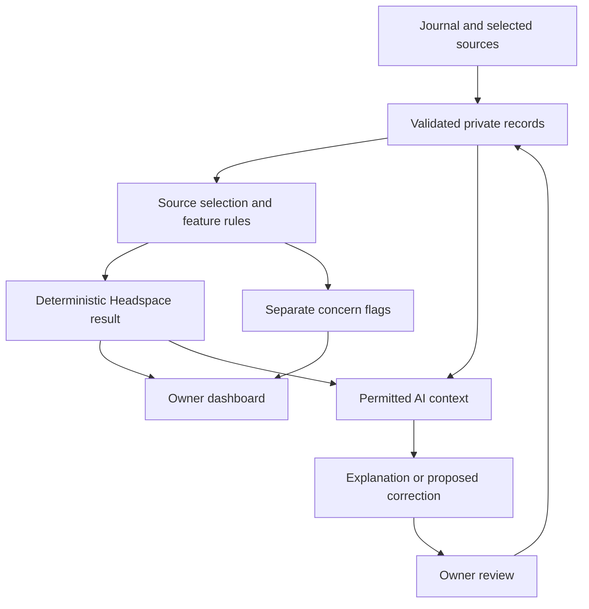

# Build sequence and acceptance

Proposed milestones, November 10, 2026. This planning task authorizes documentation only. Implementation, live integration changes, and release remain distinct work. Complete Headspace before building the future Holding Space partner dashboard.

## Keep the architecture small

Keep raw observations, normalized facts, derived features, and results distinguishable. They can live in the existing application and database. AI has no path that directly changes a calculation or grants access.

## Milestones

| Milestone | Concrete deliverable | Exit evidence |
| --- | --- | --- |
| H0: inspect and stabilize dependencies | Current source inventory, existing journal behavior, account/synthetic separation, tombstones, and live tool capabilities | Read current handoff; verify active projection fixes independently; keep dirty work and draft maintenance changes separate |
| H1: journal-first Headspace | One daily check-in, structured fallback, supported extraction, short-entry clarification, corrections, state words, reasons, freshness | Synthetic journal matrix passes; desktop and phone-width review; a real owner-authorized save/readback when ready; no numeric Headspace grade in ordinary presentation |
| H2: source selection and Oura | Per-metric source policy and one verified ingestion path for selected Oura data | Retry has one effect; source revisions are preserved; missing watch does not override valid ring data; a real authorized transfer is distinguished from synthetic tests |
| H3: MyFitnessPal and Apple import | Reviewed MFP ingestion plus a bounded Apple export subset and compatible fallback selection | Complete/partial diary semantics, deduplication, method boundaries, timezone cases, rejected unsupported records, and readback |
| H4: clinical and optional cycle context | Selected clinical imports, relevant context, optional cycle/symptom entries, separate assistant permissions | Units/dates/reference ranges retained; conflicts reviewed; no clinical or reproductive penalty; prohibited context absent from assistant output |
| H5: candidate scoring in shadow mode | Versioned candidate components, coverage gates, deterministic reasons, baseline rules, comparison with current/simple models | All replay cases reproducible; no change to the live state from a shadow result; pilot review shows whether added inputs help |
| H6: release the evaluated owner experience | Chosen calculation and interface, rollback, backups, source status, manual mode, optional explanations | Acceptance matrix, physical iPhone check, owner review of meaningful states, correct retention/deletion, and a documented versioned release |
| H7: Holding Space planning/build begins | Separate partner product using the stable result contract | Headspace H6 complete; privacy and consent contract reviewed before partner implementation |

H1 is useful without any device. H2 through H4 should ship as bounded source capabilities rather than waiting for every record type. H5 is where candidate weights are tested, not an excuse to delay the basic journal product.

## Suggested code placement

Reuse current public interfaces. A small internal `tracking/headspace/` package may become useful as the code grows, but avoid moving working modules merely for aesthetics. Candidate responsibilities:

| Responsibility | Existing anchor | Proposed extension |
| --- | --- | --- |
| Journal and confirmation | `tracking/journal.py`, `journal_continuity.py`, `journal_registry.py` | More explicit recovery observations and time/subject handling as necessary |
| Current display | `tracking/headroom.py` | State-word presentation, evidence qualifiers, reasons, and correction links |
| Recovery pattern | `tracking/sobriety_pattern.py` | Versioned behavior-specific rules; preserve separate meaning |
| Source data | Oura models, `tracking/oura/`, `tracking/summaries.py` | Identity-safe normalized records and source preference selection |
| Clinical context | `tracking/clinical.py` | Reviewed source imports, versioned relevance, permissions |
| Trends | `tracking/trends.py`, existing chart UI | Comparable source series, baseline and coverage metadata |
| MCP/browser boundary | `dashboard/mcp_server.py`, existing services | Shared authorization, idempotency, receipts, and explicit save semantics |

Before changing observation aggregation, inspect the model constraints and current behavior. `score_day` iterates eligible observation rows while display factors use another aggregation path. The replacement must define distinct dimensions, current versus historical windows, duplicates, contradictions, and late corrections explicitly. This is a required review, not a claim that an untested production bug has been proven.

## Minimal durable records

Reuse existing records first. Add a source selection policy, a versioned scoring configuration, and a result provenance record only where current models cannot represent them. Every result should identify owner, date/window, profile, formula version, input revisions, source policy version, component availability, internal calculation, state, concern flags, reason codes, computation time, and supersession.

Keep observation and concern reasons structured. For example, `sleep_below_personal_baseline` can point to the selected records and comparison window. An explanation can then be regenerated without changing the underlying calculation. Do not persist a fabricated clinical rationale from an AI response.

## Acceptance matrix

| Fabricated case | Required result |
| --- | --- |
| Two distinct confirmed state dimensions, no wearable | Journal-only state works with source qualifier |
| One dimension repeated many times | Does not satisfy the distinct-dimension gate |
| Short structured check-in with all required fields | Equivalent to a long entry containing the same facts |
| Placeholder or I am okay with no usable fields | Entry can be saved; prompt or structured route offered; no guessed numeric state |
| Negative journal with coping and explicit no use | Distress, coping, and no use preserved; no disclosure penalty |
| Positive mood with high reported urge and low coping confidence | Recovery concern stays visible despite a favorable composite |
| Historical use or another person's experience | Not saved as current owner use |
| Voice transcription uncertainty | Pending clarification; correction updates dependent results |
| Repeat save request | One entry and one result revision, with an idempotent receipt |
| Contradictory current observations | Conflict visible; deterministic resolution rule, no silent choice |
| Oura available and watch absent | Selected ring metrics used; no missing-watch penalty |
| Same Oura sleep copied through Apple Health | One contribution, with preserved lineage |
| Apple SDNN and Oura RMSSD | Separate series and baselines |
| Two provider accounts, same date | Account identity retained; no iteration-order winner |
| Personal and synthetic data share a date | No cross-contamination, even in retries and projections |
| Deleted projection is imported again | Suppression remains; no resurrection or read failure |
| Diary is partial with few calories | Intake unknown; no undereating deduction |
| MFP totals plus underlying food entries | One daily intake, not the sum of both representations |
| Source fails or Apple read produces no data | Correct availability state; no inferred nonwear or deception |
| Several missed expected check-ins | Evidence ages and participation prompt appears; last state retains its original date |
| Tracking pause, planned rest, or inapplicable routine | No false missed-routine event |
| Current medical condition or cycle entry | Context only unless a separately evaluated rule is explicitly selected |
| Persistently elevated resting HR with no use report | Medical concern context, no substance-use attribution |
| Several check-ins show recovery during the day | Current observation updates; historical lows remain historical |
| Midnight, daylight saving transition, night shift, or travel | Defined local-day/window policy; no duplicate or lost day |
| Provider revision or late correction | Deterministic superseding result, reproducible historical inputs |
| AI unavailable or malformed proposal | Manual structured path and scoring still work |
| Journal contains instructions to override rules | Stored as untrusted text; no permission or weight change |
| Owner revokes an assistant's lab access | Labs and revealing derived reasons absent from that assistant's context |
| Current evidence is insufficient | No falsely current Steady state or invented low state |

These cases require meaningful service and integration tests, not just checks that a template contains a label. Run the project's existing verification path appropriate to the implementation. Isolated synthetic checks, actual connector operation, physical-device behavior, and deployment are separate evidence categories.

## Pilot review and decision record

For each candidate, record what changed, why, source support, exact version, test evidence, owner feedback, measured burden, unresolved limitations, and the decision to keep, adjust, or reject it. Shadow results must be marked as experiments in storage and never mixed with accepted personal history.

Initial private review schedule can be agreed during implementation. No recurring task is created by this document. Ask the owner to label meaningful days only when they want to contribute that information. Outcome nonresponse stays unknown. Do not ask them to create high-risk situations to test prediction.

## Holding Space: anticipate now, implement later

Define a stable summary contract now:

* State word, evidence qualifier, source window, last update, and calculation version.
* Generic shareable reason codes with a separate permission check for each detail.
* Owner ID and recipient-specific grants enforced on the server.
* Consent version, revocation time, access audit, and optional expiration.
* Explicitly separate raw journal, journal existence, clinical records, reproductive data, location, and notification details.

The future partner dashboard gets only the selected view. A shared Headspace word does not grant the underlying journal or clinical reason. Its Trends section exists but only displays granted metrics; no grants means nothing shared. Preserve the existing requirement that a partner needs a name and phone, with optional email. Existing partner management and manual Reach Out remain unchanged.

A partner login must be a separate identity from the owner's account. A phone number or shared owner alias is not that access boundary. Server authorization must apply to pages, exports, files, APIs, and assistant retrieval. Payment or gifting never grants health access.

Automatic notifications are future work after Headspace validation. They need separate owner and recipient consent, trigger version, sustained-window rule, cooldown, deduplication, revocation and opt-out behavior, and distinctions between requested, sent, provider-accepted, delivered, and acknowledged. No hidden alert is triggered simply because the owner wrote an honest journal.

Location remains deferred. Preserve room for optional owner-named place events and quality metadata. Do not collect continuous location now or infer addiction from visiting a location. Background iPhone behavior requires its own native capability and consent review.

## Handoff boundaries

Read the latest `AGENTS.md`, `docs/ROADMAP.md`, `docs/CURSOR_HANDOFF.md`, `docs/VERIFICATION.md`, and original build prompt before implementing. Preserve existing identities and coordination threads. Review the owner's private governing framework through an authorized private path when a rule depends on it; never copy it into Git.

This package does not authorize changing live integrations, importing real records, deploying a score, buying software, installing dependencies, sending notifications, merging the unrelated maintenance PR, or modifying ongoing fixes. The current user request is satisfied by researching and saving this plan. Future implementation should begin with the bounded H1 deliverable and its acceptance cases.
